# Hi, I'm Brian James Sager 👋

4th year Computer Engineering student at FEU Institute of Technology, Philippines.
I build embedded and IoT systems with machine learning on the edge, and I am growing my skills in cybersecurity and networking.

## 🛠 Tech Stack

**Languages**

**Frameworks and Libraries**

**Machine Learning and Vision**

**Embedded and IoT**

**Tools, Cloud and Networking**

## 📌 Featured Projects

- **[Portfolio](https://briansager.github.io/)**: My full portfolio with projects, awards, and certifications
- **[WuWa Build Tracker](https://github.com/briansager/wuwa-build-tracker)**: Echo build scorer with in-browser OCR (React, TypeScript, Tailwind CSS) | [Live demo](https://wuthering-waves-build-tracker.vercel.app/)

## 📊 GitHub Stats

## 🔥 Activity

## 📫 Contact

- Portfolio: https://briansager.github.io
- LinkedIn: https://www.linkedin.com/in/brianjamessager/
- Email: brianjames.sager@gmail.com
